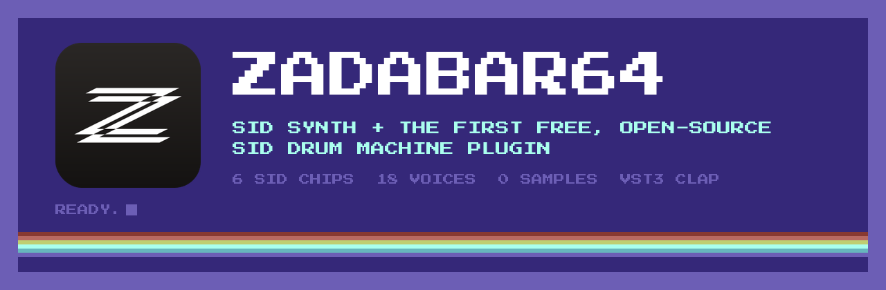
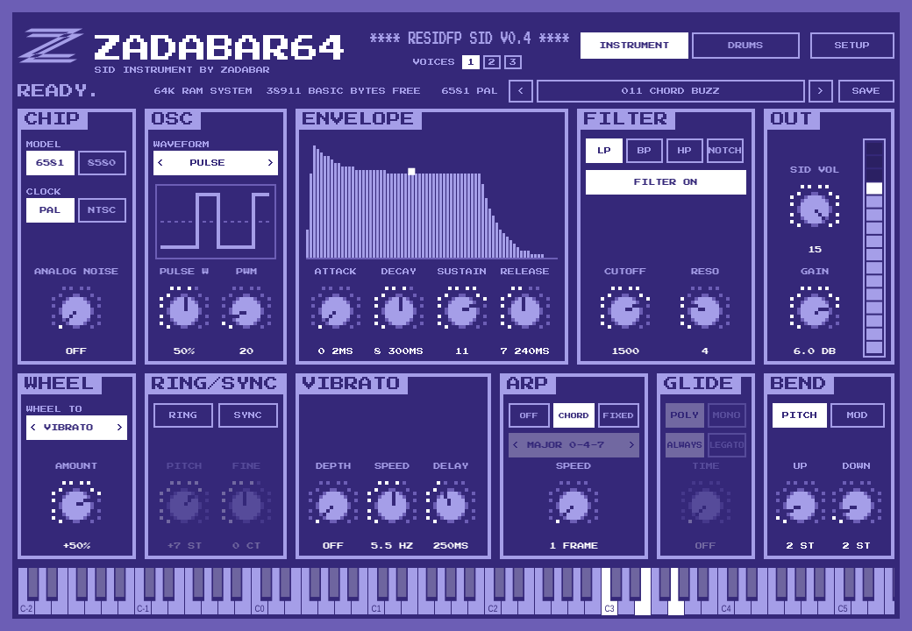
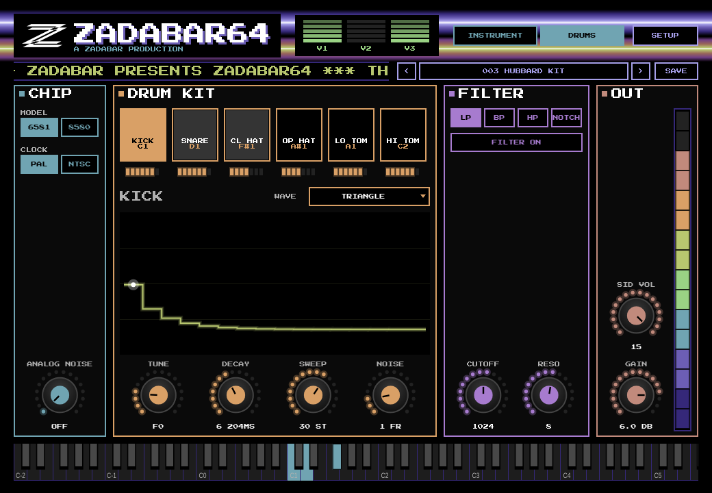
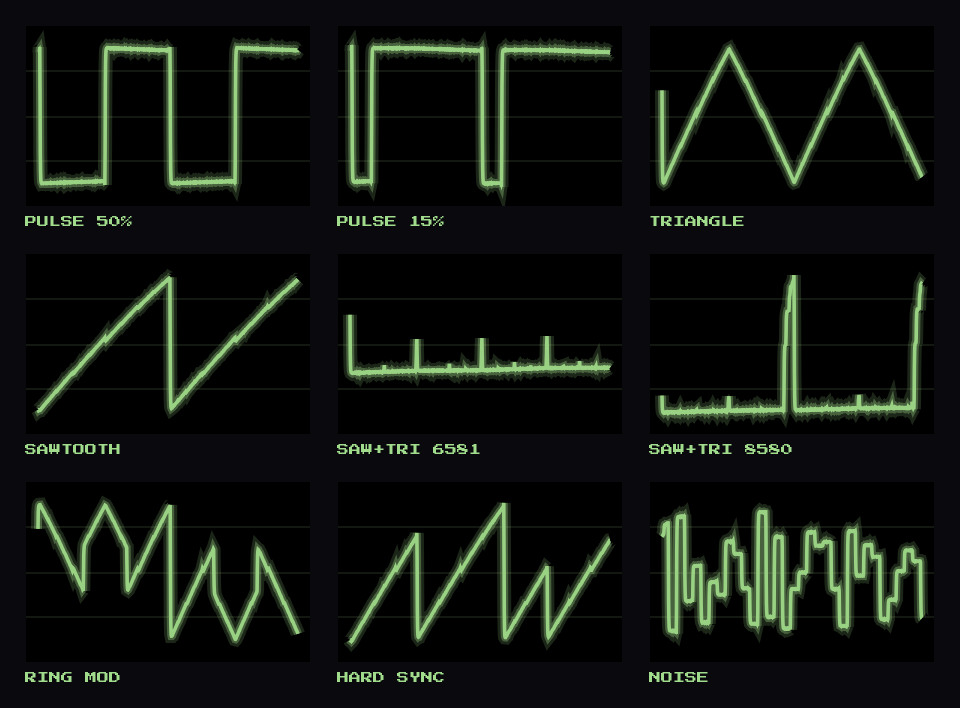
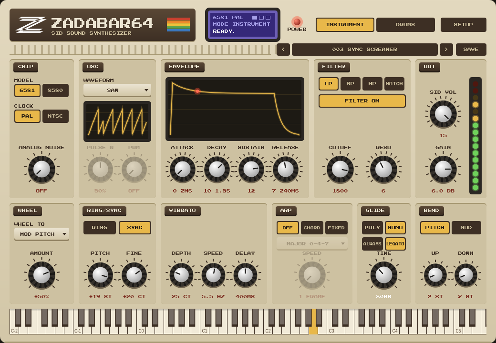
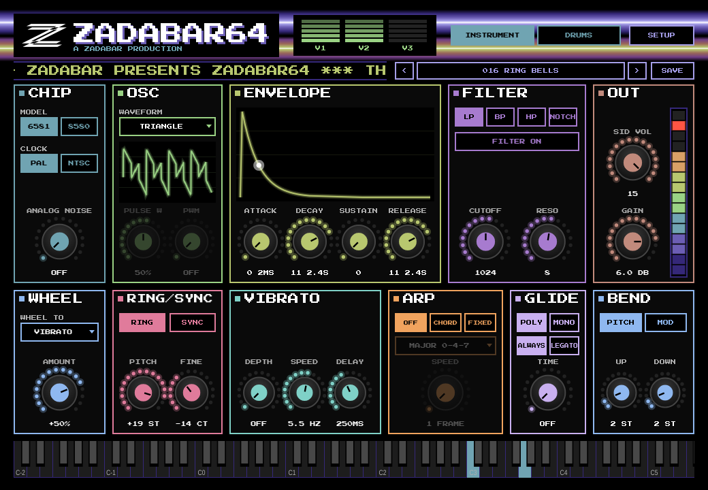

<div align="center">



### A Commodore 64 SID synthesizer and the first free, open-source SID drum machine plugin.
**Not samples. Not an imitation. The real chip, simulated one clock cycle at a time.**

[](https://github.com/zadabar/zadabar64/releases/latest)
[](https://github.com/zadabar/zadabar64/releases)
[](LICENSE)


**[⬇ Download](https://github.com/zadabar/zadabar64/releases/latest)** ·
**[🔊 Hear it](https://zadabar.com/#sounds)** ·
[Features](#-the-sid-drum-machine) ·
[Install](#-install) ·
[Build](#-build-from-source) ·
[How it works](#-how-it-works) ·
[zadabar.com](https://zadabar.com)

<br>



</div>

---

## ▶ What is it?

**Zadabar64** is a free VST3 / CLAP instrument and standalone app that plays through
**[reSIDfp](https://github.com/libsidplayfp/libresidfp)**, the cycle-accurate emulation of the
Commodore 64's SID chip used by sidplayfp. Every oscillator, envelope generator and filter
stage runs at the real C64 clock (985,248 Hz PAL or 1,022,727 Hz NTSC) and is then resampled
to your DAW's rate.

Two instruments in one plugin, switched in the header:

|  | |
|---|---|
| 🥁 **DRUMS** | Six SID drums, **each on its own SID chip**, designed frame by frame the way C64 music drivers did it. A level fader per drum, zero latency, and no hit is ever late or choked. |
| 🎹 **INSTRUMENT** | A SID synthesizer with the tricks C64 musicians used: PWM, ring mod, hard sync, vibrato, glide and the 50 Hz **arpeggio chord**. |

Pick the **MOS 6581** (1982: warm, dirty, nonlinear filter) or the **CSG 8580** (1987: clean,
bright, loud combined waveforms), PAL or NTSC, and one of three skins.

---

## 🥁 The SID drum machine



The SID has three voices and an envelope generator with a famous bug: retrigger a voice and the
note can start **up to 33 ms late**. That is why drums on a real C64 stumble when they play fast.

Zadabar64 gives **every drum its own SID chip** (six chips running at once) and inside each chip
rotates the hits over the three voices, arming the next one before it is needed. Measured result:
**0 late or swallowed hits out of 72** at 250 / 125 / 62 ms spacing, and every hit within 0.7 ms of
the beat, with **no added latency**.

<table>
<tr><td valign="top" width="40%">

| Drum | MIDI note |
|---|---|
| Kick | C1 · 36 |
| Snare | D1 · 38 |
| Closed hat | F#1 · 42 |
| Open hat | A#1 · 46 |
| Low tom | A1 · 45 |
| High tom | C2 · 48 |

<sub>General MIDI drum notes, so any drum pattern just plays.</sub>

</td><td valign="top">

**Per drum you shape**
- **Tune**: the base pitch
- **Decay**: the SID's own release rate
- **Sweep**: how far the pitch drops, frame by frame
- **Noise**: frames of noise burst at the start (the click)
- **Wave**: triangle, saw, pulse, noise, or the noise/pulse **"Hubbard"** snare
- **Level**: a real fader, because each drum has its own chip

</td></tr>
</table>

Click the pads to audition, pick one of 8 factory kits (Classic 64, Hubbard, Galway, 8580 Tight,
Boomy 6581, Electro 64, Lofi Saw ...) or build and save your own.

---

## 🎹 The SID instrument

<table>
<tr>
<td width="50%">

**Oscillator**
- Triangle, saw, pulse, noise and the four **combined waveforms**
- Pulse width + **PWM** sweep at the frame rate
- Live **oscilloscope** drawn by a hidden SID chip

**Envelope and filter**
- The SID's own 0–15 ADSR with the real timings shown
- Low-pass / band-pass / high-pass / notch, 11-bit cutoff, 4-bit resonance

**Ring mod and hard sync**
- Voice 3 as the modulator, at **MOD PITCH / FINE** from your note
- Works on every note of a chord: each note gets its own chip

</td>
<td width="50%">

**Vibrato and glide**
- Depth, speed, delay, stepped once per frame like a C64 player routine
- Glide always or legato only; poly (3 notes) or mono with last-note priority

**Arpeggio: the C64 chord**
- **CHORD**: hold a chord, one voice plays it as a buzzing arpeggio
- **FIXED**: 11 patterns (major, minor, octave, 7ths ...)
- 1–4 frames per step, timed from the note start, **frame-exact**

**Play it live: wheel, bend, MIDI learn**
- **Mod wheel** to vibrato, cutoff, resonance, pulse width or **MOD PITCH** (a hard-sync sweep),
  with a bipolar amount, set per patch
- **Pitch bend** with separate up/down range (0–24 semitones), on the note or only on the
  ring/sync modulator
- **MIDI learn**: right-click any knob, switch or list, move a control on your controller.
  Saved with the project; set a default map for new instances under SETUP

**Everything else**
- 21 factory patches, save your own
- Knobs that can't change the sound right now are dimmed

</td>
</tr>
</table>

### The oscilloscope shows the real chip



The waveform display is not a drawing of what the wave *should* look like. A seventh SID chip
plays your settings silently and the scope shows its output: notice how quiet SAW+TRI is on the
6581 and how loud it is on the 8580. That is the real hardware difference.

---

## 🎨 Three skins

<table>
<tr>
<td align="center" width="33%"><br><b>READY.</b><br><sub>The C64 start-up screen. Pixel knobs, a bar-graph envelope, the blinking cursor.</sub></td>
<td align="center" width="33%"><br><b>Breadbin</b><br><sub>The beige 1982 hardware: chunky knobs, a blue C64 monitor, a red power LED.</sub></td>
<td align="center" width="33%"><br><b>Demoscene</b><br><sub>Raster bars, a text scroller and glowing colour-coded knobs.</sub></td>
</tr>
</table>

Change the skin on the **SETUP** page. It's a per-user setting, not saved in your projects.

---

## 🎛 Factory sounds

> 🔊 **[Listen to all of them on zadabar.com](https://zadabar.com/#sounds)**, rendered straight out of the plugin.

| | |
|---|---|
| **Leads** | Hubbard Lead · Sync Screamer · Galway Flute · 8580 Brass · Thin Pulse Lead |
| **Basses** | Acid SID Bass · Octave Bass · Pulse Bass · Sync Bass |
| **Chords & arps** | Chord Buzz · Slow Chord Arp · Minor Arp Keys · Dom7 Stab · 2 Octave Sparkle |
| **Bells, pads, FX** | Ring Bells · Metal Gong · SID Pad · Saw+Tri Organ · Noise Wind · Siren |
| **Drum kits** | Classic 64 · Hubbard Kit · Galway Kit · 8580 Tight · Boomy 6581 · Electro 64 · Lofi Saw Kit |

Your own patches are plain files in `Documents\Zadabar64\` (`.z64patch`, `.z64kit`): easy to back
up and to share.

---

## 📏 Measured, not guessed

Every feature was checked by rendering audio offline and measuring it.

| What | Measured | Target |
|---|---|---|
| Arpeggio step, PAL | 19.84 ms | one PAL frame = 19.95 ms |
| Arpeggio step, NTSC | 16.81 ms | one NTSC frame = 16.72 ms |
| Drum hits late or swallowed | **0 of 72** | 0 |
| Drum timing in Live mode | within 0.7 ms of the beat | no latency |
| Vibrato rate | 5.5 Hz | 5.5 Hz setting |
| Muted ring/sync modulator | −105 dB | inaudible |
| Silence | digital zero | idle chips are not clocked |
| CPU, 3-note chord | ~6 % of one core | |
| Validation | pluginval strictness 7 ✔ · clap-validator ✔ | |

---

## ⬇ Install

**Windows 10 / 11, 64-bit.** Download **`Zadabar64-<version>-Windows-x64.zip`** from
**[Releases](https://github.com/zadabar/zadabar64/releases/latest)**, right-click it →
*Properties* → tick **Unblock**, extract it, and copy what you need:

| You use | Copy | To |
|---|---|---|
| Cubase, Ableton Live, Studio One, FL Studio, Reaper, Bitwig … | the **`Zadabar64.vst3` folder** | `C:\Program Files\Common Files\VST3\` |
| Bitwig, Reaper, FL Studio … (CLAP) | `Zadabar64.clap` | `C:\Program Files\Common Files\CLAP\` |
| no DAW | `Zadabar64.exe` | anywhere: it's the standalone app |

Then rescan plug-ins in your DAW. **`INSTALL.txt`** in the ZIP has the step-by-step guide, rescan
tips for each DAW, updating, uninstalling and troubleshooting.

> ℹ️ Nothing else to install: no runtime, no driver, no account. The files are not code-signed,
> so the standalone app shows "Windows protected your PC" the first time: *More info → Run anyway*.

**macOS / Linux:** no binaries yet. Zadabar64 builds and runs on Linux from source (see below);
macOS should build too but is untested.

**Why no VST2?** Steinberg stopped licensing the VST2 SDK in 2018 and its licence is not
compatible with the GPL. Every current DAW loads VST3.

---

## 🔧 Build from source

Everything else (JUCE, reSIDfp, the CLAP wrapper) is downloaded by CMake on the first configure.

**Requirements**

| | |
|---|---|
| **Windows** | Visual Studio 2022 or 2026 with *Desktop development with C++*, CMake ≥ 3.22, Git |
| **Linux** | GCC ≥ 11 or Clang ≥ 14, CMake ≥ 3.22, Git, and JUCE's dependencies:<br>`sudo apt install libasound2-dev libjack-jackd2-dev libfreetype-dev libfontconfig1-dev libx11-dev libxcomposite-dev libxcursor-dev libxext-dev libxinerama-dev libxrandr-dev libxrender-dev libgl1-mesa-dev` |
| **macOS** | Xcode 15+, CMake ≥ 3.22, Git (untested) |

**Build**

```bash
git clone https://github.com/zadabar/zadabar64.git
cd zadabar64
cmake -B build -DCMAKE_BUILD_TYPE=Release
cmake --build build --config Release --parallel
```

On Windows you can simply run **`.\build.ps1`**.

The results are in `build/Zadabar64_artefacts/Release/`:

| Format | Path |
|---|---|
| VST3 | `VST3/Zadabar64.vst3` |
| CLAP | `CLAP/Zadabar64.clap` |
| Standalone | `Standalone/Zadabar64(.exe)` |

**Options**

| CMake option | Default | |
|---|---|---|
| `ZADABAR_CLAP` | `ON` | Build the CLAP plug-in too (via [clap-juce-extensions](https://github.com/free-audio/clap-juce-extensions)) |

**Making a release ZIP (Windows)**

```powershell
.\release\make-release-zip.ps1          # builds Release, then packs
.\release\make-release-zip.ps1 -NoBuild # packs what is already built
```

Writes `release\Output\Zadabar64-<version>-Windows-x64.zip` (VST3, CLAP, standalone,
`INSTALL.txt`, `README.txt`, licences) and its `.sha256`. The version comes from
`project(Zadabar64 VERSION …)` in `CMakeLists.txt`.

---

## 🧠 How it works

<details>
<summary><b>Six chips for drums, one chip for the instrument</b></summary>

One reSIDfp chip costs about 5–6 % of a CPU core whether it plays one voice or three (a third of
that is the 6581 filter model, a quarter the sinc resampler). So Zadabar64 runs as few chips as it
can: in instrument mode all notes share **one chip**, like on a real C64. Only when ring mod or
hard sync is on does each note get its own chip, because those need a spare voice as modulator.
In drum mode each drum has its own chip, so drums never cut each other off and each gets a real
fader. Idle chips are not clocked at all: silence is digital zero and costs nothing.
</details>

<details>
<summary><b>Beating the ADSR bug</b></summary>

The SID's envelope rate counter is a 15-bit LFSR that wraps every ~33 ms. Gate a voice at the wrong
moment and the attack waits for the next wrap. And at gate-on the chip uses the *decay* rate for
one cycle, which made about 1 hit in 9 late. Drums rotate over the three voices of their chip and
arm the next voice (AD/SR 00, gate off) ahead of time, open the gate with decay 0 and write the real
decay one sample later. The instrument offers **Live** (no latency, authentic) or **Tight** (a hard
restart before every note with 40 ms host-compensated latency) on the SETUP page.
</details>

<details>
<summary><b>A player routine at the frame rate</b></summary>

Vibrato, PWM, glide, arpeggios and the drum programs are computed once per C64 frame, 50.12 times a
second on PAL and 59.83 on NTSC, exactly like a C64 music driver. You can hear the steps; that is
the point. Arpeggio steps are timed from the note start, so every step is exactly N frames long.
</details>

<details>
<summary><b>Ring mod and sync that work in chords</b></summary>

On a SID, voice 1 is ring-modulated or synced by voice 3. With ring/sync on, every note gets its own
chip: voice 1 plays the note, voice 3 runs at MOD PITCH above it and is muted with the chip's own
3OFF bit ($D418 bit 7). With sync, the modulator plays the note and the oscillator is offset, so
the pitch you hear stays on your note.
</details>

<details>
<summary><b>No thumps</b></summary>

Switching the filter routing, chip model or mode makes a 6581's output jump to a new resting
level: summed over six chips, a loud thump. Zadabar64 fades out on the old settings, switches
muted, lets the chips settle, re-centres its DC blocker on the new level and fades back in.
</details>

---

## 🗂 Project layout

| Path | What it is |
|---|---|
| `src/PluginProcessor.*` | Audio processing, chip mixing, state, the switching fade |
| `src/player/` | The player routine: voices, drums, arpeggio, vibrato, glide, mod wheel, pitch bend, frame ticks |
| `src/sid/SidChip.*` | Thin wrapper around one reSIDfp chip |
| `src/patches/` | Patch manager and the factory patches |
| `src/ui/` | Editor widgets, the three skins, setup page, patch bar |
| `src/Parameters.h` | All parameters, ranges and display texts |
| `src/MidiLearn.*` | MIDI learn: CC → parameter map, saved with the project |
| `cmake/libresidfp.cmake` | Builds libresidfp without autotools |
| `resources/` | Pixel font (with its licence), logo and icons |
| `release/` | Release ZIP script, INSTALL/README templates, licence texts |
| `docs/` | Images used by this README |

---

## 🤝 Contributing

Found a bug or have an idea? **[Open an issue](https://github.com/zadabar/zadabar64/issues)**. Please
include your Windows version, DAW and what happened. Pull requests are welcome; by contributing you
agree that your code is released under the GPL-3.0-or-later.

---

## 📜 License and credits

**Zadabar64** is free software: you can redistribute it and/or modify it under the terms of the
**[GNU General Public License v3.0 or later](LICENSE)**. The music you make with it is yours.

| | |
|---|---|
| Zadabar64 | **Zadabar** of Crisis Productions |
| SID emulation | [reSIDfp](https://github.com/libsidplayfp/libresidfp) by Dag Lem, Antti Lankila and Leandro Nini (GPL-2.0-or-later) |
| Framework | [JUCE](https://juce.com) 9 (AGPL-3.0) |
| CLAP | [clap-juce-extensions](https://github.com/free-audio/clap-juce-extensions), CLAP SDK (MIT) |
| Font | [Press Start 2P](https://github.com/google/fonts/tree/main/ofl/pressstart2p) by CodeMan38 (SIL Open Font License 1.1) |
| The SID | Bob Yannes, MOS Technology, 1981 |

Full details in **[THIRD_PARTY_NOTICES.md](THIRD_PARTY_NOTICES.md)**. The Zadabar logo is not
covered by the GPL; please don't use it for other projects.

<sub>Commodore 64 is a trademark of its respective owner; Zadabar64 is not affiliated with or
endorsed by it. VST is a registered trademark of Steinberg Media Technologies GmbH.</sub>

<div align="center">
<br>

```
READY.
█
```

</div>
